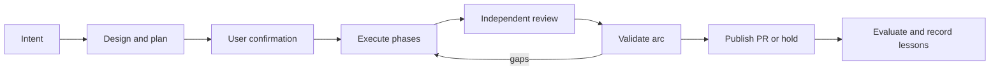

# Codex intent-to-PR compatibility review

**Date:** 2026-09-04  
**Reviewed against:** `codex-cli 0.153.2`, zeroh-roadmap `0.39.1`  
**Scope:** Read-only review of the plugin manifest, skills, agent cards, CLI, arc workflow, landing engine, and Gauntlet 1.0/2.0 evidence. This document proposes changes; it does not ratify or implement them.

## Executive verdict

The plugin is a strong phase/arc execution and intent-to-land system, but it is **not yet a valid or fully reliable Codex intent-to-PR plugin as written**.

The core protocol is usable after named adaptations. Disk-derived state, typed halts, phase gates, executor arms, overlap checks, independent validation, and evidence-driven prompt dieting are sound foundations. The blocking gaps are:

1. the current Codex plugin package fails the official `0.153.2` validator;
2. Codex has no adapter that fulfills `arc-plane.workflow.mjs`'s injected-agent/watchdog contract;
3. Claude-shaped hooks and custom agent cards do not become Codex-native enforcement or agent types;
4. terminal protocol inconsistencies can skip evaluation or mishandle recovery;
5. landing merges/pushes an integration ref but never creates a pull request;
6. consumer `AGENTS.md`, Nx, access-boundary, and sandbox policies are not first-class protocol inputs.

## Verified capability matrix

| Capability | Status | Evidence |
|---|---|---|
| Skill discovery | Blocked until package repair/install | `.codex-plugin/plugin.json` declares `skills`, but official validation currently fails and the plugin was not installed in the reviewed session. |
| Phase planning/execution | Strong protocol | `skills/plan-phase/SKILL.md`; `skills/do-phase/SKILL.md` |
| Sequential task commits and transparency | Strong, one ordering defect | `skills/do-phase/SKILL.md:42-74` |
| Arc orchestration | Adaptation required | `skills/do-arc/SKILL.md`; `workflows/arc-plane.workflow.mjs` |
| Architect/developer roles | Semantically portable | Agent cards can be delivered to a generic/native child or a headless peer CLI. They are not automatically Codex `agent_type` values. |
| Claude hooks on Codex | Unsupported | Codex manifest deliberately does not discover `hooks/hooks.json`; current manifest's empty `hooks` key is itself invalid. |
| Cross-driver Claude/Codex launches | Partially implemented | `MULTI-DRIVER.md`, `cli/lib/drivers.mjs`, and `cli/lib/roles.mjs` model both drivers and headless-child reachability. |
| Landing/push | Implemented, consequential | `cli/lib/landing.mjs:592-624,737-891` |
| Pull-request creation | Missing | No provider command, auth probe, create/update operation, receipt, or idempotent resume exists. |
| Complete intent-to-PR | Not achieved | The implemented terminal is land/optional push, with `main`/`master` explicitly held for a human. |

## Required corrections

### R1. Repair the Codex package before evaluating runtime fidelity

The official plugin validator reports three errors:

- `.codex-plugin/plugin.json` contains unsupported field `hooks` (`:20`);
- `.codex-plugin/plugin.json` lacks the required `interface` object;
- `skills/full-code-review/SKILL.md` has invalid YAML frontmatter because its unquoted description contains `Not this skill:`.

Remove the manifest `hooks` field, add valid `interface` metadata, quote or fold the affected description, rerun the official validator, reinstall/cache-bust the plugin, and prove surfacing with `codex debug prompt-input`. An installed-plugin listing is not sufficient evidence that every skill reached the model.

### R2. Add a Codex orchestration adapter

`workflows/arc-plane.workflow.mjs:61-75` throws unless the caller injects `agent()`. The injected contract must also re-await the **same** executor after a watchdog wake (`:66-69`, `:265-299`). Codex's collaboration API can spawn, message, follow up, and wait, but the workflow is not directly invocable as a native Codex workflow and its promise-race semantics are not automatically supplied.

Implement a harness-neutral orchestration interface with driver adapters:

```ts
interface AgentRunHandle {
  runId: string
  role: string
  driver: 'codex' | 'claude'
  awaitEvent(timeoutMs: number): Promise<
    | { type: 'result'; value: unknown }
    | { type: 'watch'; verdict: unknown }
  >
  message(text: string): Promise<void>
}

interface AgentDriver {
  probe(): Promise<CapabilityReceipt>
  start(request: RoleRunRequest): Promise<AgentRunHandle>
  resume(receipt: RunReceipt): Promise<AgentRunHandle>
}
```

Persist the run receipt before launch. A watchdog wake must retain the same `runId`; it must never call `start` again until liveness proves the incumbent dead and the arm is explicitly reconciled.

### R3. Make Codex ↔ Claude symmetric through driver adapters

The desired bidirectional operation is feasible:

```text
Roadmap orchestrator
        |
        +-- resolve role + model + driver
        |
        +-- Codex adapter --> native spawn_agent OR headless `codex exec`
        |
        `-- Claude adapter --> native Agent OR headless `claude -p --agents`
```

The repository already models Codex as a headless child and Claude as a headless child in `cli/lib/drivers.mjs:43-85`, while `MULTI-DRIVER.md:65-86` defines native, child-cli, and inline fulfillment. Preserve that design, but do not treat registry claims as live capability proof.

For each run:

1. probe the actual executable, version, auth, model availability, custom-agent support, resume support, and sandbox posture;
2. resolve the requested role through `resolveRole`;
3. deliver the complete agent card plus the minimum protocol envelope;
4. pass prompts through stdin or a private temporary file, never shell interpolation;
5. persist driver/model/version/run id/worktree/base SHA/card digest/permission profile;
6. validate the typed result before disarming;
7. record substitutions and forbid judge self-review where `inlineFallbackLegal` is false.

Codex native `agent_type` values are runtime allowlisted. Therefore a plugin agent card must not assume that `agent_type: software-architect` exists. When it does not, spawn an allowed generic worker/default child with the complete architect card in its prompt and record `via: native-envelope`; alternatively launch the registered Claude child. Claude may similarly launch a Codex headless child through the Codex driver.

Do not use `--dangerously-bypass-approvals-and-sandbox` as the Codex default (`cli/lib/drivers.mjs:53`). Add explicit profiles such as `inherit`, `workspace-write`, and `isolated-unsafe`; default to `inherit`. A child cannot enlarge the parent's authority merely because the protocol requests it.

### R4. Add an explicit PR terminal

`skills/do-arc/SKILL.md:62-76` ends with sweep, validate, and land. `cli/lib/landing.mjs:737-891` merges or fast-forwards locally, cleans worktrees, emits a RunnerSummary, and may push the base ref. `cli/lib/landing.mjs:591-623` refuses autonomous `main`/`master`. There is no PR implementation.

Add a separate integration mode and terminal:

```text
sweep-clean
  -> validated
  -> branch-published
  -> pr-open | pr-updated | held-for-auth | held-for-review | pr-failed
  -> evaluated
  -> complete
```

For `arcIntegration: pr`, do not merge the arc branch into the base branch before opening the PR. The provider adapter must support auth preflight, remote/base/head resolution, create-or-find idempotency, update of an existing PR, draft/ready policy, persisted URL/number/head SHA, and safe resume after push or API failure. Keep merge/release as a separate human or explicitly authorized operation.

### R5. Repair terminal and recovery contradictions

- Router and `eval-arc` promise do-arc Step 9 evaluation, but current `do-arc` contains only three terminal handoffs and ends at land. Restore an explicit eval transition or remove both promises.
- `--pause-after <N>` is advertised in `do-arc:23-24` but is not passed to or enforced by `arc-plane.workflow.mjs`.
- The workflow emits `unobserved` at `arc-plane.workflow.mjs:292-297`; `do-arc:50-60` has no handling rule for it.
- `failed` has no documented retry, abandon, rollback, or corrective transition.
- Stalled/exited text suggests relaunch, while watchdog exits intentionally leave an executor arm standing (`arc-plane.workflow.mjs:316-329`). Require liveness reconciliation before respawn.
- Validation may execute corrective phases (`validate-arc:87-107`) after the sweep. Every corrective phase must loop back through whole-arc sweep before validation and landing.
- `do-phase:49-53` says commit, then persist `done` and transparency in the same commit. Persist those fields before making the single task commit, then verify its SHA.
- Define `plane` consistently as an ordered group of phases; `MULTI-DRIVER.md:15` currently calls it one phase.

### R6. Make repository governance a mandatory input

Agent cards currently prioritize consumer `CLAUDE.md`, but Codex repositories may be governed by `AGENTS.md` and repository skills. Add this invariant to every mutating entry point and child envelope:

> Read all applicable repository instruction files before planning or mutation. Repository access boundaries, task runners, and safety policy override plugin defaults. Complete required boundary checks before editing. A restricted boundary yields a typed halt unless explicitly authorized. Use repository-native task orchestration such as Nx when required.

For the Zeroh workspace this means `pnpm boundary:explain -- --paths ...` before edits and `pnpm nx ...` for build/test/lint targets. The plugin must not translate an Nx target into a direct underlying-tool command.

### R7. Strengthen Codex lane identity

The worktree protection is generally strong, but Codex lacks Claude's session environment and may fall back to an ephemeral CLI PID (`cli/lib/worktree.mjs:69-84`). Persist a durable orchestrator-issued lane/run id (for example a Codex thread id when available), and bind claims, arms, beacons, and result receipts to it.

## Strong recommendations

1. Encode the lifecycle and authority envelope in a typed artifact rather than deriving all terminal meaning from scattered files. Include allowed remotes/refs, push/PR/merge authority, external-write policy, and required human gates.
2. Replace Claude-specific action vocabulary such as `SendMessage` with harness-neutral actions resolved by the adapter.
3. Describe validation judges as source-edit-constrained rather than read-only: builds and tests can mutate caches or contact external systems. Run them in an isolated worktree with explicit external-side-effect policy.
4. Add capability receipts with freshness and host identity. A historical probe is evidence of past support, not present availability.
5. Make post-merge failures explicit. Some current landing errors can occur after local integration has already mutated state; results must distinguish `landed-with-poststep-failure` from `not-landed`.
6. Preserve dirty-tree ownership. At review time the marketplace contained a modified `roadmap/arc-evals/lessons.jsonl` and untracked `plugins/zeroh-roadmap/OPUS-OPTIMIZATION-2026-07.md`; neither belongs to this review.

## Gauntlet assessment

### Gauntlet 1.0

Gauntlet 1.0 provides the stronger evidence for behavioral prompt quality: frozen contracts, sealed held-out tasks, isolated contestants, anonymized deliverables, and blind judges (`GAUNTLET-PROMPT.md:13-60`). Its reported result that approximately 40% of plausible rewrites regressed is a valuable warning against stylistic simplification.

Its reproducibility weakness is that primary evidence lives in private home-directory archives and consumer branches (`GAUNTLET-2026-08.md:51-58`). Add a redacted evidence manifest, hashes, tool/model versions, exclusions, and replay instructions to the repository without publishing sealed prompts.

### Gauntlet 2.0

Gauntlet 2.0 is strong evidence for protocol-load dieting, not whole-workflow correctness. It classifies 158 passages, requires named implementation/test evidence before deletion, uses architect ratification, ratchets a measured load ceiling, and restores passages when execution exposes regressions (`GAUNTLET-2.0.md:31-93,141-172`).

The inference boundary must remain explicit: only two phases across two drivers were sampled; there was no Opus baseline; the Sol baseline was historical; and absolute scores were known-invalid because landing discarded evidence later fixed in phase 28 (`GAUNTLET-2.0.md:97-113,174-191`). The trials did not exercise full do-arc sweep, validation, landing, evaluation, or PR creation. Rename the broad verdict `trial-confirmed` to `phase-execution sampled` where it describes the whole body set.

### Proposed Gauntlet 3.0

Add end-to-end held-out scenarios that cover:

- valid installation and complete skill surfacing on current Codex;
- clean and dirty consumer worktrees;
- native Codex child, Codex→Claude child, and Claude→Codex child;
- unavailable model substitution and unjudged termination;
- multi-plane execution and same-executor watchdog wake;
- escalation, self-descope, failed, stalled, exited, and unobserved paths;
- corrective validation followed by re-sweep;
- push/auth/network interruption and idempotent resume;
- PR create/update/held paths;
- fresh-session continuation from disk;
- consumer `AGENTS.md`, Nx, and access-boundary compliance.

Score state-transition completeness, outcome correctness, independence of judges, permission adherence, and artifact integrity separately from prose adherence and token load.

## Recommended delivery order

1. Fix the three Codex validation errors and prove skill surfacing.
2. Replace the unsafe default Codex launch profile.
3. Add repository-instruction and boundary precedence.
4. Repair the current protocol/implementation contradictions.
5. Implement the harness-neutral driver/run-handle adapter and durable lane identity.
6. Add `arcIntegration: pr` and the typed PR receipt/state machine.
7. Run Gauntlet 3.0 before calling the plugin a complete intent-to-PR workflow.

## Final assessment

The original Claude-first architecture does not need to be discarded. Its role cards and protocol bodies can remain the semantic source of truth. The missing layer is a tested harness adapter that translates role execution, messaging, waiting, liveness, permissions, and typed returns for each driver. With that adapter, Codex can orchestrate Claude Code agents and Claude Code can orchestrate Codex agents without either pretending to possess the other's native agent API.

Until the required corrections land, the accurate product claim is:

> Phase- and arc-driven intent-to-land workflow with experimental multi-driver Codex/Claude support.

After the adapter, terminal repairs, and PR plane pass an end-to-end Gauntlet, the stronger intent-to-PR claim will be justified.

---

## Claude-native parity addendum

**Reviewed against:** Claude Code `2.1.257` and the primary sources of `obra/superpowers` on 2026-09-04.

### Parity verdict

All required improvements above can be implemented **without degrading Claude Code**, provided the project keeps one semantic protocol and separate harness envelopes/adapters. The target is identical observable outcomes and artifacts, not identical internal mechanisms.

```text
                       shared semantic core
          skills + role cards + schemas + CLI state machine
                              |
                +-------------+-------------+
                |                           |
        Claude envelope                Codex envelope
      native agents/hooks          skills + driver adapter
                |                           |
      Claude driver adapter          Codex driver adapter
                +-------------+-------------+
                              |
                 typed receipts and artifacts
```

Claude should continue using native plugin agent cards, Agent dispatch, `SubagentStop`/`Stop` hooks, and transcript-aware enforcement. Codex should use its own valid manifest, available native agent types or role envelopes, and persisted CLI/state-machine enforcement where hooks are unavailable. Both may launch the other as a headless child through the same driver abstraction.

### Current Claude baseline

`claude plugin validate plugins/zeroh-roadmap` passes on Claude Code `2.1.257`, with three warnings:

1. `.claude-plugin/plugin.json` places `category` in the plugin manifest, but Claude expects it in the marketplace entry and ignores it here.
2. root `CLAUDE.md` is not loaded as plugin context; executable protocol must remain in skills/agent cards rather than relying on this file.
3. `agents/references/executor-reference.md` is scanned as an agent but has no frontmatter. Move supporting documents outside `agents/`, to a reference location loaded explicitly by the executor card.

These warnings are not load failures, but clearing them makes component discovery intentional and prevents future validator tightening.

Claude Code exposes the mechanisms the Claude design expects: `--agents`, `--agent`, `-p`, `--json-schema`, background sessions, session IDs, attach/log/stop/respawn, resume, worktrees, tool allow/deny lists, and named permission modes. The adapter should use these supported surfaces rather than infer liveness from process output alone.

### Effect of required improvements on Claude

| Improvement | Claude-native effect | Parity condition |
|---|---|---|
| Repair Codex manifest | None | Change only `.codex-plugin/plugin.json`; retain `hooks/hooks.json` and Claude agent cards. |
| Codex orchestration adapter | Additive | Extract a harness-neutral run-handle contract; retain a Claude adapter backed by native agents/background sessions. |
| Symmetric Claude/Codex launch | Improves Claude | Claude can launch `codex exec`; Codex can launch `claude -p --agents`. |
| PR terminal | Improves both | Put PR behavior in the shared CLI state machine; both harnesses receive the same receipt. |
| Terminal/recovery repairs | Improves both | Encode transitions in shared code/schema rather than maintaining harness-specific prose variants. |
| Repository governance precedence | Improves both | Load applicable `AGENTS.md`, `CLAUDE.md`, and repository-native rules without assuming one filename is universal. |
| Durable lane identity | Improves both | Use orchestrator-issued run IDs and additionally record native session IDs. |
| Safer permission inheritance | Improves both | Driver default is `inherit`; native permission controls remain authoritative. |

### What must remain harness-specific

1. **Installation and manifests.** Claude and Codex validate different shapes. Never generate one by copying the other.
2. **Hook enforcement.** Claude may block an invalid `SubagentStop`; Codex should reject the equivalent result-ingestion transition. Parity is the same rejected state change, not the same hook.
3. **Agent identity.** Claude plugin agent names are native attribution; Codex agent types are runtime allowlisted. Persist semantic `roleId` independently of native type.
4. **Messaging and resume.** Hide Claude background IDs and Codex task/session identifiers behind `AgentRunHandle`.
5. **Permissions.** Record a normalized authority envelope plus the raw native policy. Never translate into stronger authority.
6. **Transcripts.** Claude hook payloads expose transcript paths used by the guard. Codex must use explicit receipts, beacons, and validated results instead of fabricating Claude transcript semantics.

### Bidirectional child-agent contract

```ts
type RoleRunRequest = {
  protocolVersion: string
  roleId: string
  agentCardPath: string
  model: string
  worktree: string
  baseSha: string
  taskArtifactPath: string
  resultSchema: object
  authority: {
    filesystem: 'read-only' | 'workspace-write'
    network: 'denied' | 'approval' | 'allowed'
    gitPush: boolean
    externalWrites: boolean
  }
}
```

The parent persists the request and run receipt before launch. The child reads the role card and task artifact, operates only in the assigned worktree, and returns schema-valid JSON. Native messaging remains useful, but all load-bearing state is on disk so a crash or compaction cannot duplicate dispatch.

For Claude → Codex: resolve the role/model; launch registered `codex exec` argv with prompt on stdin; inherit permissions by default; capture the run identity; validate the result through the same schema and phase arm.

For Codex → Claude: resolve the role/model; launch `claude -p --agents <json>` or a background/resumable session; generate the explicit agent definition from the committed role card; use `--json-schema`; preserve plugin/hooks unless deliberately bare; record session ID, model, plugin version, permission mode, and substitution.

Cap nested cross-driver delegation, recommended `maxDriverDepth: 1`. A Claude child launched by Codex must not launch another Codex child for the same role, and vice versa.

### Shared conformance suite

| Case | Claude parent | Codex parent | Required common result |
|---|---|---|---|
| Native architect | Claude Agent | Codex role envelope | Same verdict shape/evidence |
| Foreign architect | Claude → Codex | Codex → Claude | Recorded child driver/model/session |
| Invalid executor return | `SubagentStop` blocks | ingestion rejects | Phase stays open; arm remains |
| Watchdog wake | background session | Codex run handle | Re-await same run; never respawn |
| Model unavailable | resolver moves tier | resolver moves tier | Same substitution or `UNJUDGED` |
| Permission denied | native permission halt | sandbox/approval halt | Same held state; no escalation |
| PR exists | shared PR adapter | shared PR adapter | Same receipt; no duplicate PR |

Run four lanes: Claude-native, Codex-native, Claude→Codex, and Codex→Claude. Pin protocol fixtures, not vendor transcript text.

## Superpowers comparison

Primary source: <https://github.com/obra/superpowers>.

Superpowers validates the core architecture: one composable skill library can support many harnesses while each harness has separate installation and packaging. Zeroh-roadmap should likewise keep shared semantics, separate valid manifests/bootstrap, and explicit capability degradation.

### Patterns worth adopting

1. **Explicit branch-finishing outcomes.** Superpowers presents local merge, push-and-PR, or keep-branch. Encode the equivalent as `mergePolicy.arcIntegration: local | pr | hold` plus typed receipts.
2. **PR before cleanup.** Its PR path pushes the feature branch, creates the PR, reports the URL, and keeps the worktree for feedback. Zeroh-roadmap PR mode should preserve the arc worktree until merge or explicit safe cleanup.
3. **Harness-specific packaging.** Add both `claude plugin validate` and the official Codex validator to CI.
4. **Fresh minimal child context.** Generate task briefs and file-backed reports; do not fork the full parent transcript by default.
5. **Durable recovery ledger.** Keep Zeroh-roadmap's stronger typed phase/arc artifacts canonical, while adding explicit run receipts and review packages.
6. **Two-stage review separation.** Explicitly distinguish specification compliance (`built the promise?`) from code quality (`built it well?`).
7. **Environment-sensitive cleanup.** Preserve unknown dirt and open-PR worktrees.
8. **No-plugin/current baseline evals.** Gauntlet 3.0 should add concurrent baselines and cross-harness lanes.

### Patterns not to copy directly

- Do not replace typed phase/arc state with free-form progress Markdown.
- Do not universally switch to one fresh implementer per task; the phase executor's continuity is useful for coupled work. Make execution strategy an explicit phase decision.
- Do not require an interactive integration menu when a reviewed policy already authorizes the safe path.
- Do not copy generic direct test commands; consumer task policy such as Nx remains authoritative.
- Do not depend on session-start bootstrap for correctness. Files and the CLI state machine must be sufficient for resume.

## Updated dual-native delivery order

1. Clear both validators: the three Codex errors and three Claude warnings; enforce both in CI.
2. Define shared protocol-version, result, authority, and run-receipt schemas.
3. Move transition enforcement into shared CLI code; retain native hooks as defense-in-depth.
4. Implement Claude and Codex `AgentDriver` adapters.
5. Add durable identity, same-child resume, recursion cap, and fresh capability receipts.
6. Add shared `arcIntegration: pr` without changing the existing Claude default.
7. Run the four-lane conformance suite and Gauntlet 3.0.
8. Only then advertise equal native Claude/Codex and complete intent-to-PR support.

### Final dual-native assessment

The improvements are compatible with the Claude-first workflow. Claude will retain richer native enforcement through hooks and agent attribution. Codex can reach behavioral parity by enforcing the same transitions at CLI/result boundaries.

The correct promise is:

> From either native parent, the same intent produces the same planned artifacts, role decisions, gated commits, halt semantics, validation result, PR receipt, and resumable terminal state; each harness uses its own validated manifest, agents, hooks, permissions, and messaging adapter.


## Documentation quality audit

### Verdict

The plugin has unusually deep design material, but its documentation is not yet a top-notch product surface. Implementation has advanced faster than the README and orientation page, normative protocol is mixed with historical evidence, and production modules carry incident archaeology that belongs in Git, ADRs, or eval reports.

The target is **concise at the point of use, deep on demand, and mechanically truthful**:

- README: what users can do now.
- Skills/references: current normative behavior.
- Architecture docs: stable design and invariants.
- ADRs/eval reports: decisions and evidence.
- Git: editing history.
- Code comments: only what a maintainer must know to change current code safely.

### P0 — Make the README the truthful front door

`README.md:1-19` has Claude-only onboarding, while `README.md:135` claims support across Claude, Cursor, Copilot, Gemini, and Codex. That exceeds current evidence: the Codex manifest does not validate, Claude validation warns, and the full workflow lacks cross-harness conformance.

Use this README structure:

1. **Outcome and audience** — what is automated and what remains user-authorized.
2. **Support matrix** — Claude Code, Codex, and other hosts marked `supported`, `experimental`, or `not tested`, with validated CLI versions.
3. **Install** — distinct Claude and Codex instructions.
4. **Five-minute path** — configure, plan, review, execute, and inspect artifacts.
5. **Lifecycle** — intent, design, implementation, review, validation, PR/hold, evaluation, and resume.
6. **Safety and authority** — destructive operations, push, merge, and PR publication.
7. **Configuration** — one minimal example and full-schema link.
8. **Recovery** — `blocked`, `stalled`, `unobserved`, dirty-tree, failed-gate, and held-for-user states.
9. **Artifacts** — discovered roadmap root and ownership/purpose.
10. **Limitations/troubleshooting** — known parity gaps and validator status.
11. **Documentation map** — operations, protocols, architecture, comparison, evals, contribution, and releases.

The diagram at `README.md:40-52` stops at validation. Replace it with a canonical Mermaid source or generated SVG:



Do not publish timing, cost, token, or quality numbers such as `README.md:87` unless generated from a named, dated benchmark with sample size and environment. `README.md:78-87` must describe actual kind-selected gates, round caps, documentation exceptions, and arc-level checks.

### P0 — Recast `docs/orientation.html` as a maintained comparison

The page is visually useful, but facts and tone have drifted:

- `orientation.html:226` says plugin `v0.34.0`.
- `orientation.html:114-122` hardcodes `roadmap/` despite root discovery.
- `orientation.html:154` omits the current middle architect tier.
- `orientation.html:121-141` presents lifecycle wiring not yet complete.
- `orientation.html:190` exposes a phase number as future product direction.
- `orientation.html:191-193` says Claude-native orchestration although dual-native is the desired, not current, contract.
- `orientation.html:98-100,176-205` calls compliance “rhetorical” and argues against a “lazy model,” weakening an otherwise useful comparison.

Cite the exact Superpowers release/commit and inspection date. Label claims as:

- **Observed fact:** repository mechanism.
- **Measured result:** reproducible evaluation.
- **Design interpretation:** a tradeoff.

Credit Superpowers' documented native harness installs, worktrees, planning, subagent execution, staged review, and explicit branch-finishing choices; then explain Zeroh-roadmap's typed lifecycle, enforcement, eval artifacts, and policy-driven orchestration. Generate HTML from maintained Markdown/data, or enforce an update checklist. A hand-edited page duplicating versions, model chains, lifecycle rules, and layouts will drift.

### P0 — Establish documentation ownership

| Information | Canonical home |
|---|---|
| Promise, install, quickstart | `README.md` |
| Executable agent protocol | `skills/*/SKILL.md` |
| Detailed current rules | `skills/*/references/*` |
| Stable architecture/invariants | `docs/architecture/*` |
| Consequential decisions | `docs/adr/*` |
| Benchmark method/evidence | `docs/evals/*` |
| Past experiments/postmortems | `docs/history/*` |
| Release-visible changes | `CHANGELOG.md` |

Move or index root-level Gauntlet, diet, optimization, and design-history documents under this hierarchy. Historical evidence stays discoverable but should not compete with onboarding or be model-loaded unless required.

### P0 — Remove archaeology from production comments

Examples occur in `hooks/heartbeat-stamp.mjs:7-10`, `hooks/session-lane-check.mjs:8`, `workflows/arc-plane.workflow.mjs:208-248`, `cli/lib/liveness.mjs:4-31`, `hooks/executor-result-guard.mjs:3-43`, `cli/lib/landing.mjs:249,594,744-798,942-1108`, `cli/lib/config.mjs:76-80`, and `cli/lib/codex-journal.mjs:4`. Internal postmortem labels also leak into user-facing errors in `cli/lib/validate.mjs:246-329` and `cli/lib/executor-arm.mjs:192-234`.

Adopt this rule:

> A code comment may explain a current invariant, non-obvious constraint, safety boundary, or why the obvious implementation is wrong. It must not narrate when the rule was learned, which phase or incident exposed it, how many attempts preceded it, or who ruled on it.

Examples:

- Keep: `Resolve symlinks before comparing ownership; link mtimes do not prove executor liveness.`
- Remove: `The 2026-08-18 incident showed...`
- Keep: `Check cheap deterministic blockers before the expensive suite.`
- Remove: `METERTENANT attempt 1 burned 65 minutes...`

Keep public API docs, units, exit contracts, concurrency invariants, and irreversible-effect warnings. Move timelines, codenames, phase IDs, trial narratives, rulings, and postmortems to ADR/eval records. Link a short ADR only where the rationale is necessary.

Do not merely delete comments: encode invariants with names, types, small functions, assertions, schemas, and tests. Prioritize `cli/lib/landing.mjs`, `cli/lib/liveness.mjs`, `cli/lib/executor-arm.mjs`, `hooks/executor-result-guard.mjs`, and `workflows/arc-plane.workflow.mjs`.

Add a review check—not a brittle ban—that flags production comments containing dates, `phase <number>`, attempt numbers, codenames, block comments over roughly eight lines outside API/module contracts, TODOs without an issue/disposition, and user errors containing incident vocabulary. Fixtures may retain identifiers when semantically required.

### P1 — Visualize only hard relationships

Maintain four small canonical diagrams:

1. Lifecycle/state machine, including corrections, holds, PR, eval, and resume.
2. Dual-harness architecture: shared core below Claude/Codex adapters; native hooks as defense-in-depth.
3. Artifact ownership: orchestrator, children, lane worktrees, phase records, gate reports, receipts, and PR state.
4. Failure/recovery sequence: beacon, watch classification, typed halt, safe resume, escalation.

Store Mermaid sources under `docs/architecture/`, render SVGs where Mermaid is unavailable, and detect generated drift in CI.

### P1 — Documentation quality gates

CI should check both plugin validators, Markdown/HTML links and anchors, generated diagrams/tables, HTML accessibility basics, practical command snippets in a fixture, metadata-derived version/model claims, and renamed lifecycle terminology.

### Acceptance criteria

Documentation is ready when:

- a new user can finish one safe phase from either supported native parent using only the README;
- every advertised command, host, state, gate, artifact, and terminal outcome is tested or linked to its contract;
- Claude/Codex differences are explicit while the semantic promise remains shared;
- the Superpowers comparison is versioned, sourced, factual, and respectful;
- history remains discoverable but non-normative;
- production comments describe current constraints rather than history;
- lifecycle, architecture, and recovery diagrams agree with the CLI state machine;
- CI prevents silent version, command, link, and generated-output drift.

### Documentation delivery order

1. Correct premature/stale README and orientation claims.
2. Add dual-harness install/status/limitations and complete lifecycle.
3. Establish the documentation hierarchy and relocate history.
4. Refactor archaeology comments while preserving invariants in code/tests.
5. Add architecture/recovery diagrams and documentation CI.
6. Run clean-room onboarding once with Claude as parent and once with Codex as parent.
